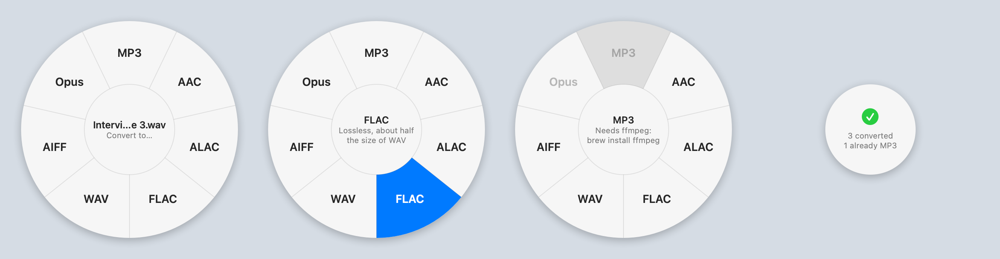

# Rondel

Rondel converts audio files on a Mac from a circular menu. Right-click a file in Finder, choose Convert Audio…, and pick a format from the wheel that opens under the pointer. The new file appears next to the original.



## Install

You need the Command Line Tools with Swift 6 or later. ffmpeg is optional but worth having: without it there's no MP3 or Opus, and tags and cover art don't come across.

```bash
xcode-select --install
brew install ffmpeg
git clone https://github.com/thisulzen/rondel.git
cd rondel
make install
```

`make install` builds the app from source, copies it to `~/Applications/Rondel.app` and tells Finder about it. It doesn't need `sudo`. Because the app is built on your own Mac, Gatekeeper doesn't block it the way it would block an unsigned download.

To remove it:

```bash
make uninstall
```

## Using it

Select one or more audio files in Finder, right-click, and choose Convert Audio…. It's near the bottom of the menu, or inside Services if you have several. The wheel opens where you clicked.

- Hover over a format to see what it's for, then click it. The middle of the wheel counts the files as they finish, then shows a summary and closes.
- Formats that can't be used show in grey, and hovering over one says why. MP3 and Opus need ffmpeg, and a format every selected file is already in is greyed out too.
- The keyboard works as well: the arrow keys go round the wheel, Return picks, 1 to 7 pick directly (clockwise from MP3 at the top), and Esc closes it. Esc during a conversion stops it.
- Clicking anywhere else closes the wheel without doing anything.

Each converted file is saved beside its original under the same name with the new extension. If that name is taken, it becomes `song 2.mp3`, then `song 3.mp3`, the way Finder names copies. Nothing is ever overwritten, and the original is never touched. A file that's already in the chosen format is skipped. If anything fails, an alert lists which files failed and why.

There are three other ways in: Open With → Rondel, dropping files on the app's icon, or opening the app by itself, which asks you to choose files.

### Formats

| Format | File | With ffmpeg | Core Audio only |
|---|---|---|---|
| MP3 | `.mp3` | LAME V0 VBR, ID3v2.3 tags | not available |
| AAC | `.m4a` | 256 kbps (128 for mono) | 256 kbps (128 for mono), no tags |
| ALAC | `.m4a` | lossless, source bit depth | lossless, source bit depth, no tags |
| FLAC | `.flac` | lossless, source bit depth | lossless, source bit depth, no tags |
| WAV | `.wav` | PCM at the source's bit depth | PCM at the source's bit depth |
| AIFF | `.aiff` | PCM at the source's bit depth, ID3 tags | PCM at the source's bit depth, no tags |
| Opus | `.opus` | 128 kbps | not available |

The sample rate and channels stay as they were, except that Opus is always 48 kHz and MP3 mixes surround down to stereo. Cover art is kept for MP3, AAC, ALAC and FLAC. WAV, AIFF and Ogg can't hold it the way players expect.

### From the command line

The same app converts without the wheel, for scripts:

```bash
~/Applications/Rondel.app/Contents/MacOS/Rondel --to flac *.wav
```

It prints each new file's path, skips files already in the format, and exits 1 if anything failed. Ctrl-C stops it cleanly.

### If Convert Audio… doesn't appear

macOS sometimes needs a nudge to notice a new service. Try these in order:

1. Open System Settings → Keyboard → Keyboard Shortcuts… → Services → Files and Folders, and tick Convert Audio….
2. Run `/System/Library/CoreServices/pbs -flush`, or log out and back in.

The first time Rondel converts something in Desktop, Documents or Downloads, macOS asks whether it can access that folder. It needs to, because the new file is saved there.

## Status

Done: the wheel, conversion to all seven formats with ffmpeg and five without, the Finder service, Open With, the command line, install and uninstall, and the tests. CI runs the tests on Apple Silicon, builds the app, checks with `pbs -read_bundle` that Finder can read its service, and converts a file with it.

Not done: there are no settings, so the bitrates above are fixed, and there's no signed download, so you build it yourself. The full list is at the end, along with what I haven't been able to check.

## Design

### Two engines

ffmpeg does the converting if it's installed, and Core Audio's `afconvert` does it if it isn't.

I started with `afconvert` alone, because it ships with every Mac and uses Apple's encoders. Then I converted a tagged FLAC to AAC and the title and artist were gone. A converter that strips the tags off a music library isn't fit for purpose, and Core Audio can't write MP3 or Opus anyway. So ffmpeg comes first. `afconvert` stays as the fallback, so a Mac with nothing installed still gets five formats, and the wheel greys out the other two and says what to install.

The cost is two sets of arguments to keep in step, and every converter test runs once per engine. With ffmpeg installed, AAC comes from ffmpeg's own encoder, and Apple's goes unused. That's the price of keeping the tags. Apple's encoder inside ffmpeg (`aac_at`) would be the next step, but not every ffmpeg build has it.

An app opened from Finder gets a PATH without Homebrew on it, so ffmpeg is looked for in PATH first and then in `/opt/homebrew/bin`, `/usr/local/bin` and `/opt/local/bin`.

### Never overwrite, never leave half a file

Each conversion writes to a hidden file in the same folder, such as `.song.1a2b3c4d.rondel.mp3`, and renames it into place only once the encoder has finished. A failure or a cancel deletes the hidden file, so a half-written file never appears under a real name.

The rename uses `renamex_np` with `RENAME_EXCL`, which refuses to replace an existing file and does it in one step. Two conversions finishing at the same moment can't both take `song.mp3`: the loser gets `song 2.mp3`. exFAT drives don't support that flag, and some network shares may not either. On those, the name is claimed first by creating it with `O_EXCL`, which is just as atomic, and the finished file is then renamed over the empty claim.

### Several at once

A batch runs as many conversions at once as the Mac has cores. On this laptop (Intel i5-8259U, 8 threads), 200 twenty-second WAVs became MP3s in 18.5 s.

### Keeping the bit depth

A 24-bit master converted to FLAC, ALAC, WAV or AIFF stays 24-bit, and a 16-bit file stays 16-bit. Core Audio reads the source's depth, which for ALAC and FLAC is tucked away in the format flags while the usual field says zero, and the PCM formats are written at that depth. Lossy sources become 16-bit, and floating-point sources become 24-bit integers, because AIFF can't hold floats.

### Why a service and not a Finder extension

A Finder Sync extension can add its own right-click menu, but it needs Xcode, a signed app extension, and a trip to System Settings to switch it on, and its menu is a list anyway. The wheel is a borderless window of its own. Getting files to it only needs a service and an Open With entry, which are a few lines in `Info.plist`. That keeps the whole build down to `swift build` and a Makefile.

The app has no Dock icon or main window. Each right-click starts it, it shows the wheel, and it quits once the last wheel closes.

## What testing turned up

Most of these came from breaking something on purpose to see whether a test would notice.

- The first version of the wheel drew as a plain grey disc on screen, with no labels at all. The frosted background was a subview of the wheel, and a subview always draws on top of its parent. The test that hovers over each slice and checks the slice turns blue caught it. The wheel now sits inside the background instead.
- My first cancel test passed even after I deleted the line that kills the encoder. The batch still came back "cancelled", just a few seconds later, once the encoder had finished on its own. The test now uses a five-minute file and checks the batch returns within a second of the cancel. For scale, a full three-minute encode took 2.1 s for MP3 and 3.6 s for AAC on this laptop. Later the same test failed by 20 ms when the whole suite ran at once: `terminate()` sends SIGTERM, and ffmpeg takes a moment to finish off a file that's about to be deleted anyway. A cancel sends SIGKILL now. Then the first CI run on Apple Silicon failed it from the other side: the thread meant to send the cancel wasn't scheduled until the encode had finished, because every test was running at once on three cores. The batch now runs on its own thread while the test's thread watches it.
- With that fixed, it still passed after I deleted the cleanup of half-written files. The cancel landed before the encoder had created its output, so there was nothing to clean up. The test now waits until the hidden file exists before cancelling.
- A file name close to macOS's 255-byte limit broke once the hidden file's suffix was added. The temporary name now uses a shortened stem.
- The exFAT fallback used to check that a name was free and then move the file there. I mounted an exFAT disk image and converted four files called `song` at once, and that version failed five runs out of five: some runs reported a spurious error, and in others two conversions ended up with the same name, so one file was silently lost. Claiming the name with `O_EXCL` fixed it, and the test now mounts an exFAT image every run.
- An empty file, which is what a failed download often leaves, came back with ffmpeg's "Invalid data found when processing input". It now says the file doesn't look like audio or is damaged, with ffmpeg's words after that.

## What's tested

There are 42 tests, run with `swift test`, plus one that only draws the wheel to PNG files for a person to look at, when `RONDEL_SNAPSHOTS` names a folder. The test audio is generated as they run: sine tones written with Core Audio, and speech from the Mac's `say` command.

- `FormatTests` covers output names, which slices are greyed out and why, and the wheel's geometry: which slice is under a point, going clockwise from twelve o'clock, and the dead zones in the middle and outside the ring.
- `ConverterTests` runs the real tools on real files, once with Core Audio only and once with ffmpeg if it's installed. It checks that:
  - every format plays back at the same length, channels and sample rate;
  - 24-bit stays 24-bit and 16-bit stays 16-bit;
  - the original is byte-for-byte unchanged;
  - an existing file is never overwritten;
  - files already in the format are skipped, including AAC and ALAC sharing `.m4a`;
  - files that aren't audio, empty files, missing files and read-only folders fail with a clear message and leave nothing behind;
  - on an exFAT disk image, four files with the same name all convert to names of their own;
  - awkward names convert: a leading dash, quotes, `&`, accents, and a name near the length limit;
  - a cancel kills a running encoder and deletes its partial output;
  - with ffmpeg, tags and cover art come across, 5.1 surround becomes stereo for MP3, and a Matroska file that Core Audio can't open still converts.
- `WheelViewTests` drives the wheel with synthetic mouse and key events and draws it offscreen. It checks that hovering over each slice lights that slice and no other, that clicks and every key do what they should, that greyed-out slices can't be picked, and that VoiceOver sees one button per format.
- `WheelControllerTests` picks a format the way a click does, then waits for a real file to be converted, the summary to show and the wheel to close. It also checks the service reads files from both kinds of pasteboard Finder can send.

### Not checked

- Nobody has clicked a slice of the real wheel yet: macOS won't let a script click a window without Accessibility permission. What is checked, on the installed app: calling Convert Audio… through the system's services, the way Finder does, launches the app and opens the wheel at the pointer; Open With opens it too; and opening the app by itself shows the file picker. The tests cover everything from the click onwards.
- The folder-access prompt for Desktop, Documents and Downloads hasn't been seen, for the same reason.
- SMB shares haven't been tried. exFAT and FAT32 disk images have.
- Built and run on macOS 15.7 on an Intel Mac, and tested on Apple Silicon in CI. Not tried on macOS 13 or 14.

## Not done

- No settings window for bitrate or quality.
- No signed and notarised download, so it has to be built from source.
- No video files in the menu.
- No percentage for one long file, just a spinner and a count of files.
- English only.
- If the app itself is force-quit mid-conversion, the hidden `.rondel` file is left behind.

## Synthetic data only

Every sound in the tests is generated as the tests run: a 440 Hz sine tone or a sentence from `say`. No recordings are included.

## Layout

```
Sources/RondelCore/
    Format.swift      The seven formats, output names, which slices are available
    Converter.swift   ffmpeg and afconvert, temporary files, renaming into place
    Batch.swift       Several files at once, progress, the summary
    Wheel.swift       The wheel's geometry
Sources/Rondel/
    main.swift        Command line, or start the app
    App.swift         The service, Open With, and one controller per wheel
    WheelView.swift   Drawing, mouse, keyboard and VoiceOver
Resources/            Info.plist and the icon
scripts/icon.swift    Draws the icon (make icon)
Makefile              app, install, uninstall, icon
```

## References

- Callahan, Hopkins, Weiser and Shneiderman, *An Empirical Comparison of Pie vs. Linear Menus* (CHI 1988). This is the case for a wheel: every choice is the same short distance from the pointer.
- Apple, [Services Implementation Guide](https://developer.apple.com/library/archive/documentation/Cocoa/Conceptual/SysServices/introduction.html)
- `man afconvert`, and the ffmpeg documentation for [libmp3lame](https://ffmpeg.org/ffmpeg-codecs.html#libmp3lame-1) and [libopus](https://ffmpeg.org/ffmpeg-codecs.html#libopus-1)
